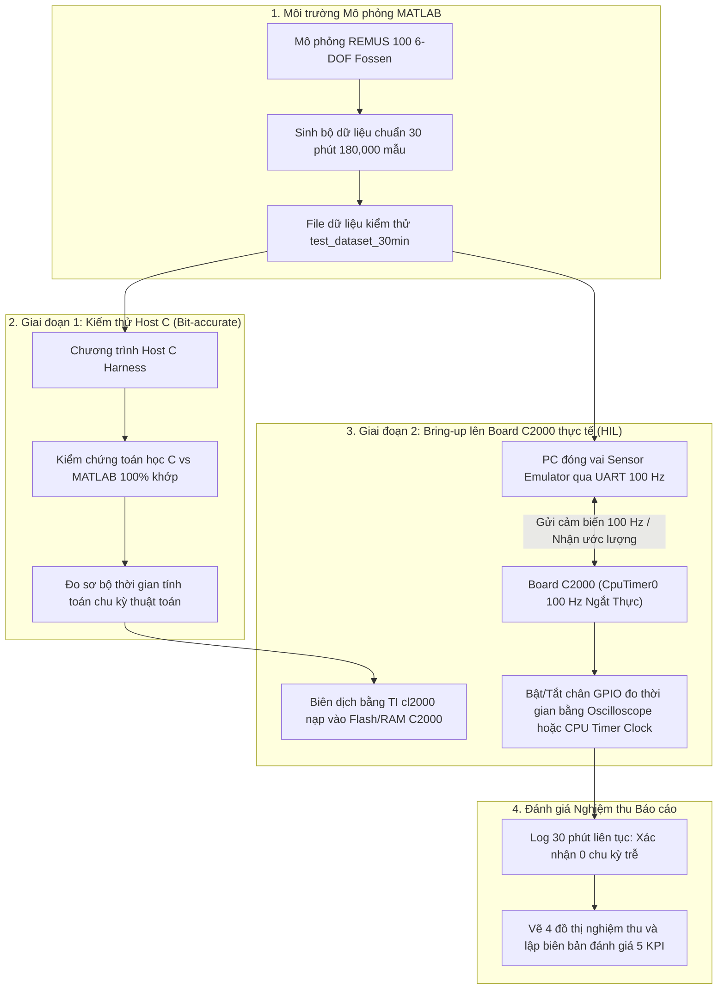

# KẾ HOẠCH TRIỂN KHAI VÀ BẢN ĐỒNG THUẬN KỸ THUẬT (TECHNICAL PLAN & DISCUSSION)
## HỆ THỐNG ĐỊNH VỊ DẪN ĐƯỜNG TÍCH HỢP ES-EKF 19 TRẠNG THÁI TRÊN NỀN TẢNG DSP TI C2000 CHO TÀU LẶN UUV

---

## I. MỤC TIÊU VÀ 5 CHỈ TIÊU KỸ THUẬT NGHIỆM THU (KPIS)
Căn cứ theo phiếu giao nhiệm vụ kỹ thuật (`TEST/nhiemvu/baf9e3dc7fe2ffbca6f3.jpg`):
1. **Nền tảng mục tiêu:** DSP TI C2000 (Dòng tối ưu nhất: **TMS320F28379D Dual-Core 200 MHz** tích hợp FPU32 và bộ tăng tốc lượng giác TMU).
2. **Tần số xử lý chu kỳ:** Tối thiểu **100 Hz** ($dt = 10\text{ ms} = 10,000\ \mu\text{s}$). Thời gian tính toán mỗi chu kỳ bảo đảm không vượt quá chu kỳ lấy mẫu ($T_{\text{calc}} \ll 10\text{ ms}$).
3. **Độ ổn định thời gian thực:** Chạy kiểm thử liên tục tối thiểu **30 phút (1800 giây = 180,000 chu kỳ)** với **0 lần trễ chu kỳ** ($N_{\text{overrun}} = 0$).
4. **Chỉ tiêu sai số định vị ngầm Dead-Reckoning:** Sai số vị trí 3D tích lũy $< 1.0\%$ tổng quãng đường hành trình ($< 1.0\%\text{ DT}$).
5. **Chỉ tiêu hiệu chuẩn trực tuyến Boresight & Scale Factor DVL:**
   - Sai số góc lệch Boresight DVL $< 0.6^\circ$ trên cả 3 trục (Roll, Pitch, Yaw).
   - Sai số ước lượng hệ số tỉ lệ tốc độ DVL Scale Factor $< 1.0\%$.
6. **Sản phẩm bàn giao:** Toàn bộ mã nguồn thuật toán C cho C2000, chương trình mô phỏng, bộ dữ liệu kiểm thử 30 phút, kết quả đánh giá định lượng.

---

## II. KẾT QUẢ THẢO LUẬN & ĐỒNG THUẬN KỸ THUẬT

### 1. Lựa chọn dòng chip DSP C2000 tối ưu
- **Đánh giá các dòng chip C2000:**
  - `TMS320F28379D / F28377D (Delfino series)`: Được thống nhất là dòng chip **ngon nhất và tối ưu nhất** cho bài toán dẫn đường robot ngầm:
    - 2 nhân C28x 200 MHz + 2 bộ tăng tốc CLA 200 MHz (tổng năng lực xử lý đạt 800 MIPS).
    - Tích hợp sẵn **Hardware FPU32** và **TMU (Trigonometric Math Unit)**: các hàm lượng giác `sin`, `cos`, `atan2`, `sqrt` (rất dày đặc trong Quaternion, DCM Euler, nhóm Lie $SO(3)$) được thực thi phần cứng chỉ trong **1 đến 3 chu kỳ xung nhịp** (thay vì 50 - 100 chu kỳ khi tính bằng phần mềm).
    - Bộ nhớ 204 KB RAM, 1 MB Flash, đầy đủ ngoại vi SPI, CAN, SCI (UART) kết nối IMU và DVL.
  - `TMS320F28388D`: Lựa chọn cao cấp mở rộng (có thêm ARM Cortex-M4 và Ethernet 100 Mbps).
- **Chế độ số học:** Định nghĩa macro `real_t` là `float` 32-bit để tận dụng 100% phần cứng FPU/TMU, đảm bảo thời gian tính toán mỗi chu kỳ đạt mức siêu tốc $< 0.5 - 1.0\text{ ms}$ (dư hơn 90% quỹ thời gian của chu kỳ 10 ms).

### 2. Phương pháp giải quyết bài toán kiểm thử 30 phút trên Board (HIL)
- **Vấn đề đặt ra:** Dữ liệu cảm biến 30 phút ở tần số 100 Hz có **180,000 mẫu** ($\approx 25 - 30\text{ MB}$), trong khi RAM của chip C2000 chỉ có 204 KB $\rightarrow$ Không thể nạp toàn bộ dữ liệu vào chip cùng một lúc.
- **Giải pháp thống nhất: Triển khai kiểm thử theo 2 giai đoạn chuẩn công nghiệp:**



#### Chi tiết Giai đoạn 1: Host C Golden Reference
- Toàn bộ code C (`esekf19_core.c`, `esekf19_math.c`) viết bằng ANSI C99 thuần, độc lập phần cứng, tuyệt đối không dùng cấp phát bộ nhớ động (`malloc`/`free`).
- Chương trình test trên PC đọc toàn bộ 180,000 mẫu và chạy kiểm thử trong vài giây.
- Đối chiếu từng bước ước lượng trạng thái và ma trận hiệp phương sai giữa code C và MATLAB: sai số tuyệt đối $< 10^{-6}$.

#### Chi tiết Giai đoạn 2: Hardware-in-the-Loop (HIL) trên Board thật
- **PC đóng vai trò Sensor Emulator (Mô phỏng cảm biến thời gian thực):** Cứ mỗi 10 ms (100 Hz), script Python/MATLAB phát 1 gói nhị phân (Sensor Packet) qua cổng Serial COM (USB UART).
- **Board C2000 xử lý thật:**
  - Nhận gói qua bộ đệm UART FIFO/DMA.
  - Ngắt phần cứng `CpuTimer0` định kỳ 10 ms (100 Hz) gọi `esekf19_step()`.
  - Kéo 1 chân GPIO lên HIGH khi bắt đầu tính, kéo xuống LOW khi tính xong (đo trực tiếp bằng que đo máy hiện sóng Oscilloscope).
  - Đọc thanh ghi bộ đếm xung clock CPU để ghi nhận thời gian tính toán chu kỳ ($\mu\text{s}$). Nếu $T > 10,000\ \mu\text{s}$, tăng cờ trễ chu kỳ `cycle_overrun_count++`.
  - Truyền gói ước lượng trạng thái ngược về PC để ghi log liên tục trong 30 phút.

---

## III. CẤU TRÚC MÃ NGUỒN C2000 DỰ KIẾN TRIỂN KHAI

```
C2000_ESEKF19/
├── include/
│   ├── esekf19_types.h       # Kiểu dữ liệu real_t, cấu trúc trạng thái 20 chiều, ma trận hiệp phương sai 19x19
│   ├── esekf19_math.h        # Thư viện đại số ma trận tĩnh, Quaternion, Rodrigues SO(3), Cholesky
│   └── esekf19_core.h        # API thuật toán: init, predict 100Hz, updates (GNSS, Depth, Mag, DVL)
├── src/
│   ├── esekf19_math.c        # Cài đặt hàm toán học tối ưu cho FPU32/TMU của C2000
│   ├── esekf19_core.c        # Cài đặt lõi lọc ES-EKF 19 trạng thái (tối ưu lan truyền ma trận thưa)
│   ├── host_test_main.c      # Chương trình kiểm thử Golden Reference trên PC đối chiếu MATLAB
│   └── c2000_hil_main.c      # Firmware chạy trên board C2000 (Ngắt Timer 100 Hz, UART, GPIO)
├── build_c2000.bat           # Script biên dịch tự động bằng TI cl2000 (CCS toolchain)
└── ke_hoach_trien_khai_c2000.md # Tài liệu kế hoạch và biên bản đồng thuận kỹ thuật này
```

---

## IV. BẢN KẾT LUẬN ĐỒNG THUẬN
- Bản kế hoạch và giải pháp HIL đã được người dùng và trợ lý thống nhất hoàn toàn.
- Tài liệu này được đưa vào hệ thống quản lý mã nguồn Git để làm cơ sở triển khai và kiểm chứng nghiệm thu cho đề tài.
